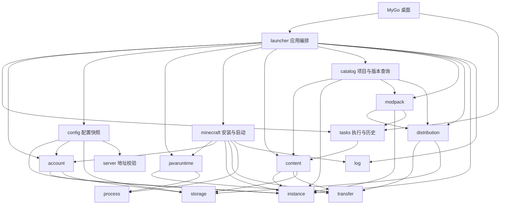

# 架构

LXMCL 使用 Go、MyGo 原生窗口和 Lobe MyGo 组件。主包负责界面状态和事件分发，后端包不依赖 UI。文件、网络和进程操作由后台任务执行，结果通过 UI 线程展示。

## 模块与接口

| 模块 | 边界与主要接口 |
| --- | --- |
| `internal/launcher` | 应用编排与外部服务适配。`Game.Execute` 接收 `LaunchRequest`，返回 `LaunchResult`；现有游戏、账号与资源 API 保持兼容。 |
| `internal/config` | `State` 管理配置快照、实例集合、账号选择和服务器收藏；`PrepareInstallation` 生成独立安装草稿；`Store` 读取、迁移及保存配置，本地平台密钥读取不进入进程环境。 |
| `internal/account` | Microsoft、皮肤站认证及外观协议；`Client` 提供可注入的网络接口，`Vault` 加密保存凭据，`LaunchIdentity` 提供已校验的游戏身份。 |
| `internal/instance` | 实例配置、加载器和启动参数校验，不执行网络或 UI 操作。 |
| `internal/minecraft` | `Client` 查询游戏与加载器目录；`Runtime` 管理原版和加载器安装、缓存校验、Java 要求与启动。`LaunchOptions` 输入身份及可选 JVM 准备回调，`Running` 返回进程和日志。 |
| `internal/javaruntime` | `Probe` / `Find` 探测 Java；`Manager.Local` 只检查本地；`Resolve` 按需求选取或安装；`Ensure` 校验并安装受管运行时。 |
| `internal/content` | `Kind` 定义资源格式；`List` / `Import` / `SetEnabled` / `WriteVerified` 管理实例资源文件，`ValidateArchive` 统一检查新文件和复用文件的格式，不依赖下载平台。 |
| `internal/catalog` | `Client` 查询 Modrinth / CurseForge 项目、版本、前置和图标；`DownloadAsset` 返回可校验的文件描述；`CurseForgeResolver` 提供整合包依赖解析。 |
| `internal/distribution` | `Asset` 描述来源、大小和摘要；`Asset.Fetch` 管理流式下载的来源、重定向和重试；`Cache.Ensure` 校验可复用缓存，`Cache.Export` 向选定文件夹发布已校验副本。 |
| `internal/modpack` | `Prepare` / `PrepareLocal` 生成不可修改的预览；`Install` 解析清单、安装到临时目录、发布文件并提交实例，失败时回滚。 |
| `internal/tasks` | `Run` 管理一次执行的进度生命周期；`Record` 保存任务目标与结果；`Journal` 串行更新历史。 |
| `internal/server` | 服务器地址校验和状态探测。 |
| `internal/saves` | 世界备份与恢复，保留已有世界。 |
| `internal/transfer` | 下载字节、摘要和大小校验、文件发布、并发批次与取消；`Retry` 统一有限次数的传输重试与服务端等待时间，业务重试由调用方决定。 |
| `internal/storage` | 文件读写、路径校验及有大小限制的完整归档 JSON 读取；`PublishNew` 在已打开目录内准备新文件并以不覆盖方式发布。 |
| `internal/process` | 平台进程属性；进程的业务生命周期由调用方管理。 |
| `internal/log` | 游戏与加载器安装器的日志路径、写入文件创建及游戏日志预览。 |
| `internal/i18n` | 从嵌入式 JSON 按键读取后端文案，保留错误链与语言回退。 |

依赖向下流动：桌面调用应用编排，编排组合领域模块和基础设施。`config`、`minecraft`、`account`、`catalog`、`content`、`distribution`、`modpack`、`javaruntime`、`tasks`、`instance` 等包不反向导入 `launcher`。任务记录可引用资源类型，不能引用桌面组件或启动器实例状态。`launcher` 的公开类型别名和薄包装保留现有调用接口，协议和文件操作交给对应模块。

## 配置与实例集合

`config.State` 是可修改的配置快照，交给后台操作或编辑草稿前调用 `Clone`。实例、账号列表及服务器收藏都复制独立切片；实例修改继续检查 ID 与修订，移除配置不操作游戏目录。`instance` 保留单个实例的校验规则，`config` 管理集合中的名称、编号和选中项。账号模块负责认证与凭据，配置中只保存选择键和展示档案。

游戏与整合包共用 `State.PrepareInstallation`：复制快照、创建实例、规范化加载器并保留有效的原启动选择。成功返回新快照和明确的安装目标，失败返回原状态，不消耗编号、不创建文件。桌面只提交表单值，安装和保存仍由应用层在后台执行。

`Store.Load` 保留 `launcher.json` 的字段和默认设置。仅在该文件不存在时导入 `launcher-settings.json` 与 `instances.json`，损坏的当前配置不会回退到旧文件；读取和迁移都不重写源文件。读取、保存和新建统一保证 `next_id` 至少大于已有最大 ID，并保留已保存的更高计数。移除实例不降低计数，编号耗尽会报告错误，避免重复编号、目录复用或整数溢出；既有 ID、目录、修订与选择不被重新分配。

`Store.Save` 以临时文件替换配置，写入由调用方串行。`launcher.State` 保留类型别名；`launcher.Store` 保留原有 `Root` 和方法，将配置交给 `config.Store`，凭据交给 `account.Vault`。配置模块不依赖任务历史、Minecraft 安装或桌面组件。`.env` 读取保持环境变量优先、再按数据目录／工作目录／程序目录查找的顺序，不展开变量，也不把密钥写入配置或进程环境。

## 启动与账号

提交时调用 `LaunchRequest.Snapshot`，捕获实例 ID、修订、游戏目录、账号、设置和服务器。`Game.Execute` 检查请求内实例与状态一致，依次完成认证、安装和启动；已安装游戏遇到 `ErrRepairRequired` 时仅修复并重试一次。只安装模式跳过认证和游戏启动。浏览其他实例不改变该请求的目标。

`launch_request.go` 定义契约，`launch_auth.go` 协调会话验证、凭据保存与账号选择的状态更新，`launch_operation.go` 编排步骤。Microsoft 和皮肤站的协议、外观、会话内部字段及凭据编解码归 `account` 管理；它不读取启动器配置，也不决定当前选中的账号。认证失败会终止本次启动；已提交的凭据或状态变化通过 `LaunchResult` 返回，即使后续下载失败也不会丢失这些变化。第三方认证仅用于选择皮肤站账号的启动请求。

`account.Client` 的零值使用标准网络传输，可通过 `Transport` 注入代理策略或协议测试。请求有超时限制且不跟随认证重定向。显式客户端提供设备码登录、Microsoft 刷新、皮肤站角色绑定与验证、外观读写和启动选项；已有会话方法使用默认客户端。皮肤站的 API 发现只允许同源跳转，authlib-injector 仍按固定官方版本校验。

会话通过 `LaunchIdentity()` 返回已校验的身份，离线身份由 `OfflineIdentity` 创建。身份的 `Arguments()` 返回独立的 Minecraft 参数映射，启动器不再读取会话内部令牌；该映射含访问凭据，不可记录到日志。身份对象本身的 JSON 和格式化输出不含令牌。`Vault` 沿用 `microsoft-account.dat` 和 `skin-stations/<key>.dat`、旧 JSON 字段及当前 Windows 用户的 DPAPI 加密；其他平台不写明文凭据。账号选择仍存于 `launcher.json`，与凭据文件分离。

调用方负责串行执行会修改配置的操作。`Execute` 在调用线程运行，应放入后台任务；进度回调也在工作线程触发。取消影响认证、下载和启动前的准备，成功创建的游戏进程独立于启动器窗口。`Running` 只表示 Java 进程已启动，`Running.Done` 表示进程退出，均不等同于游戏可玩。

## Minecraft 安装与启动

`minecraft.Client` 的零值访问固定官方来源，`Transport` 可注入传输而不能更改来源和重定向校验。`Catalog`、`Releases`、`LoaderVersions` 与 `FabricVersions` 不依赖实例状态；JSON 必须完整且不超过 8 MiB。`Runtime{Cache, Client}` 复用该传输安装游戏、加载器和受管 Java，不导入 `launcher`、资源平台查询或整合包模块。

`Installed` 只做缓存存在性检查。`Install` / `InstallWithJava` 校验实际文件并补齐缺损；`Start` 每次校验收据、元数据、资源索引、库与素材，再合并加载器参数、选择 Java 和创建进程。`LaunchOptions.Identity` 必须来自账号模块；皮肤站的 authlib-injector 准备通过 `PrepareJVM` 延迟注入，在文件和 Java 检查通过后才执行。回调失败或启动前取消均不会创建游戏进程。`ErrRepairRequired` / `ErrJavaRequired` 保留错误身份，应用层决定是否修复、重试或引导选择 Java。

内部按元数据、文件清单、安装、收据、校验、加载器协议、启动参数和进程分文件。共享缓存继续使用 `versions/<id>`、`libraries`、`assets`，Fabric / Quilt 沿用各自目录，Forge / NeoForge 保留游戏版本、加载器版本和平台分层。新收据记录官方版本摘要及平台；历史 `verified = 1` 仍兼容，启动会校验其元数据列出的文件，显式修复后升级收据。调用方串行执行同一实例和缓存的写操作。

资源文件下载通过 `distribution.Asset.Fetch` 与 `content.WriteVerified` 组合，不再依赖 Minecraft 下载器。`Fetch` 在每次尝试中调用消费者，消费者负责摘要、归档格式校验及原子发布；缓存消费者使用 `CopyVerified`。CurseForge 和 Modrinth 的 CDN 跳转分别保持在对应平台范围内，文件请求不继承 API Cookie。

## Java 运行时

需求来自已校验 Minecraft 元数据的 `javaVersion.component` 和 `majorVersion`。显式 Java 路径优先且失败时不回退；自动模式依次检查系统和受管缓存，再下载官方运行时。诊断调用 `Local`，不会触发下载。

自动安装当前支持 Windows x64，使用 Mojang 官方目录和 HTTPS 下载来源。清单路径、类型、大小、大小写冲突及文件摘要均先校验；下载到同级临时目录，全部文件校验并实际探测版本后，以唯一目录名发布。失败或取消会清理本次临时目录，旧安装保持可用。再次使用时校验清单与全部文件。并发安装在进程内串行化，任务可在等待时取消。

运行时按 `cache/java/windows-x64/<component>/runtime-<manifest-sha1>-<id>/` 保存。原版启动和 Forge / NeoForge 安装共用这一模块；未来增加平台适配时需实现该平台清单类型、可执行位及真实探测，不能直接复用 Windows 路径假设。

## 任务与重试

`tasks.Run(ctx, work, report)` 是一次执行，负责开始前取消检查、串行进度和结束后屏蔽迟到回调。游戏启动、资源任务和整合包安装均接入此接口。工作函数须响应 context 并等待自己的子任务结束。调度、业务重试和 UI 节流由调用方负责。

传输层的 `Retry` 最多执行三次，等待时间取退避时间和 `Retry-After` 中的较大值；超过 30 秒的服务端等待交给用户稍后重试。取消会中断等待。官方文件、CurseForge API 和平台文件缓存共用该策略；业务完整性或格式错误不会被视为临时网络错误。

新记录在提交时生成稳定 ID，进程启动和退出更新同一条记录。每个数据目录使用一个 `Journal`，写入者串行合并当前记录并保存临时文件，避免旧任务覆盖后来记录。内存快照以不可变数据发布，UI 读取不获取磁盘写入锁，也不能通过修改资源指针影响历史。写入失败单独报告，内存保留实际任务结果。

首次读取历史失败时不会标记为已加载，后续写入继续报告读取错误并保留原文件；修复文件后可以重试加载。读写限制均为 2 MiB，完整 JSON 文档必须有效，合法数组后的垃圾数据也会拒绝。超大结果不会覆盖已保存的历史。

`tasks.json` 保持原 JSON 数组和最近 24 条上限；旧记录通过时间戳匹配，原有中文状态与动作值保留为存储标识，不能随界面语言改变。重试目标由 `launcher.RetryTarget` 检查实例 ID、修订、版本及账号；资源重试还保留资源版本或独立文件夹。旧配置变化后不猜测新的目标。

## 文件、资源和安装

实例使用独立游戏目录，共享经过官方哈希和大小校验的下载缓存。Minecraft 目录、元数据、安装校验、参数和进程启动分文件维护；Forge 安装器、运行库与配置，以及整合包清单和实例安装流程分别维护。

`catalog` 中的 Modrinth / CurseForge 适配器负责查询、版本选择和下载来源；`content` 负责 JAR / ZIP 格式、文件名、实例目录访问、启停和导入校验。已有资源同时通过大小、摘要和加载器标记检查后才能复用；失败会保留原文件。添加资源只安装选中文件，必要前置由用户选择。

`catalog.Client` 的零值可用，通过 `Transport` 注入网络传输；超时、API 主机、凭据和重定向策略归模块维护。API 请求不跟随重定向，完整 JSON 响应最多 8 MiB，取消和限流等待复用 `transfer`。CurseForge 密钥仅由该 API 的请求及解析器持有，图标和文件请求不接收密钥。`.env` 读取、实例选择和状态持久化属于 `config`，下载任务由 `launcher` 编排。

资源目录的 `PackProject` / `PackVersion` / `PackFile` 保持原 JSON 字段，`ResourceFilter` 表示查询条件。`DownloadFile` 供界面选择展示文件，`DownloadAsset` 校验已选文件的来源、正大小及 SHA-512；目录列表与作者指定版本仅提供可校验的文件，不会因主文件无效而改用其他附件。前置浏览只查询元数据：在实例内验证原实例的版本和加载器，在独立浏览时尊重作者指定版本；未指定版本的 Fabric API 仍可回退到 Quilt API 包。

`ModpackRelease` 的来源、文件描述和平台下载限制由目录模块持有。`DownloadAsset` 返回独立描述，修改展示文案或返回的 URL 列表不能改变平台限制。游戏或加载器不支持时仍允许保存可校验归档；安装入口还需通过整合包解析和实例校验。图标接口自行注册 PNG、JPEG、GIF 和 WebP 解码器，读取上限 2 MiB、尺寸上限 2048 × 2048，输出 96 × 96 图像，不依赖桌面初始化。

`distribution.Asset` 支持 SHA-512、SHA-1 和 MD5，保留 `cache/modpacks/<algorithm>/<digest>` 路径；每次复用重新读取并校验文件，下载成功后才以临时文件发布。`Cache.Client` 可注入网络传输和超时，来源与重定向限制仍由模块执行。CurseForge CDN 的重定向不能跳出其 CDN 域名集合，API 密钥不参与文件下载。

`Cache.Export` 在下载前打开选定目录，复用缓存后再次校验实际复制字节，发布成功才报告完成。`launcher` 只选择文件描述并翻译进度。实例资源的 `WriteVerified` 负责大小、摘要与加载器归档标记，两者都通过 `storage.PublishNew` 发布：先写入同目录随机 `.lxmcl-*.part`，回调完成校验，再同步、关闭写入文件并原子创建最终名称。同名文件、目录和符号链接均保留；准备失败或取消只清理本次临时文件，不删除最终名称。

发布目标始终基于已打开目录。Windows 使用原生句柄重命名并禁用覆盖，不依赖硬链接；其他平台使用同目录硬链接创建最终名称，再清理临时名称，不支持硬链接的文件系统会返回错误。进程在发布前退出可能留下 `.part`，资源列表不会将其视为 JAR / ZIP，重试使用新的临时名称；不自动删除其他操作留下的临时文件。这里保证文件可见性，不承诺突然断电时的目录持久性。Windows 接口见 [NtSetInformationFile](https://learn.microsoft.com/en-us/windows-hardware/drivers/ddi/ntifs/nf-ntifs-ntsetinformationfile) 与 [FILE_RENAME_INFORMATION](https://learn.microsoft.com/en-us/windows-hardware/drivers/ddi/ntifs/ns-ntifs-_file_rename_information)。

资源写入在复制前和归档校验后检查对应 `.disabled` 文件，保留已有禁用资源。同实例内的资源操作仍由调用方串行；启用与禁用两个名称无法作为一对原子检查，不保证与外部进程同时启停资源的事务隔离。

`modpack.Prepared` 仅公开 `Info()`，保留值比较能力以供桌面识别当前预览；归档位置和指纹由模块持有。安装时重新核对指纹，防止预览后的文件变更。Modrinth、CurseForge 清单解析、路径计划、文件填充和发布事务分别维护，内部 ZIP 条目与安装计划不暴露给调用方。Forge 安装器使用 `storage.ReadArchiveJSON`，不依赖整合包解析器或整合包文件限制。

`modpack.InstallOptions` 接收目标实例、缓存、依赖解析器、游戏安装函数和配置提交函数。CurseForge 适配器实现 `Resolver.Resolve`，为每个必需的项目/文件引用返回一条经过平台权限检查的文件描述；模块再次检查数量、路径、大小和摘要。选装及服务器专用文件按清单规则跳过，空整合包文件不会被标为可安装。

`launcher` 检查提交时的实例与状态快照一致，并注入游戏校验和 `Store.Save`。整合包模块在同级临时目录完成归档、依赖和游戏安装后才发布实例目录，然后调用配置提交函数；提交失败会尝试将目录移回临时位置并清理，回滚错误与原错误一并返回。提交函数必须与其他配置写入串行，并在失败时保留旧状态。整个操作由后台任务执行，浏览其他实例不会改写其目标。

Forge / NeoForge 官方客户端安装器在独立缓存临时目录运行，不执行整合包脚本或沿用已有 Minecraft 配置。运行库按加载器、游戏版本和平台隔离；Fabric / Quilt 使用各自官方启动配置。Maven 回退仅切换预设 HTTPS 来源下的同一路径，校验值仍来自官方元数据。CurseForge 密钥只用于官方 API，不发送给下载来源或 Java 子进程。

## 扩展约定与参考

增加下载平台时在 `catalog` 中实现查询与文件描述适配，复用 `content` 和 `distribution`；增加整合包格式时在 `modpack` 中实现解析并复用计划校验和安装事务；增加后台操作时提交独立目标快照，复用 `tasks`，在所属业务模块决定重试条件；新增日志格式或输出去向进入 `log`；新增文案同时维护中英文 JSON 的键和格式参数。接口由实际调用需求决定，目前没有插件 SDK、任务恢复调度器或账号提供者注册框架。

设计参考了 [HMCL 的 Mojang Java 安装任务](https://github.com/HMCL-dev/HMCL/blob/main/HMCLCore/src/main/java/org/jackhuang/hmcl/download/java/mojang/MojangJavaDownloadTask.java)中运行时安装的独立职责，以及 [Prism Launcher 的任务接口](https://github.com/PrismLauncher/PrismLauncher/blob/develop/launcher/tasks/Task.h)中进度、取消与结束状态的区分。这里使用 Go context、明确的请求/结果和组合实现，未引入它们的任务类继承结构或复制实现源码。
