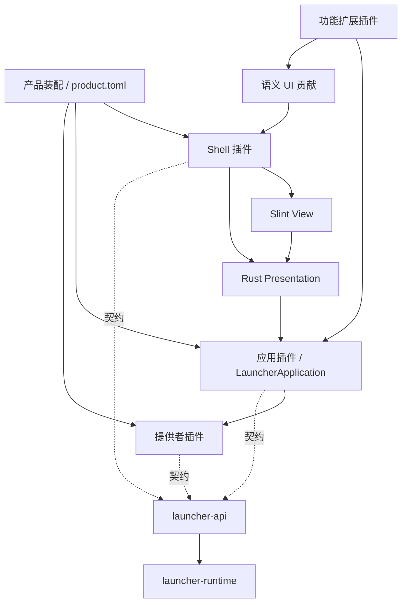

# 架构设计

LXMCL 采用同进程的原生前后端：Slint 负责视图，Rust 展示层处理交互，应用用例层协调业务，插件提供具体能力。产品负责组合这些部分，Runtime 负责依赖和生命周期。这里的“前后端”是代码边界，无需启动本地 HTTP 服务。

**本文包含待实施的架构设计。** 当前 SDK 以[插件开发](plugins.md)及源码为准；真实 / 演示能力见[开发指南](development.md)。外观与交互统一维护在 [UI Skill](../.agents/skills/lxmcl-ui/SKILL.md)。

## 1. 当前基础与要解决的问题

| 当前实现 | 需要调整 |
|---|---|
| Runtime 已按名称与类型强制检查 get / provide 声明，确认服务属于当前作用域 | 保留拓扑、回滚和清理；新插件必须完整声明依赖 |
| 设置、实例、Java 是独立提供者；重命名由 Application 插件协调 | 创建、Java 选择等流程仍需从 Shell 和线程桥迁移 |
| `ApplicationShell` 已允许整套 UI 替换 | `run(&PluginHost)` 可查全部服务，容易继续把业务放进 Shell |
| Rust State、Slint AppState、Guidance 均保存部分业务状态 | `journey` 从多处拼接启动上下文，权威状态与展示投影混合 |
| `UiRoute` 已类型化 | Shell 多处仍直接修改整数 page / category / section |
| `rename(id, expected_revision, name)` 已核对修订；共享 JSON 仓库串行创建 / 重命名 | 写入协调仅限同一提供者实例，不代表跨进程支持 |
| 扩展命令返回 `Result<String, String>`，回调投递结果 | 仅适合简单操作，不能承担结构化任务状态与重新订阅 |

对应源码：[Context](../crates/launcher-runtime/src/context.rs)、[宿主](../crates/launcher-runtime/src/host.rs)、[实例提供者](../crates/launcher-instances/src/lib.rs)、[装配](../src/composition.rs)、[准备适配](../src/journey.rs)、[扩展适配](../src/shell_extensions.rs)。迁移保留现有提供者和 worker，不重建整套框架。

## 2. 目标依赖与职责

以下是目标调用关系。Application / Presentation 已为实例重命名建立独立路径，其余业务仍按功能迁移：

| 边界 | 拥有的内容 | 不应承担 |
|---|---|---|
| Runtime | 工厂目录、服务注册、依赖拓扑、作用域、通用有界执行器 | Minecraft、Slint、业务服务名、页面路由 |
| API | 稳定目标、请求 / 结果 / 错误、可替换服务契约、语义贡献 | 窗口对象、提供者实现、持久化格式 |
| Application | 用例校验、目标快照、后台任务、业务状态提交、启动流程 | Slint 模型、焦点、动画、颜色 |
| Provider | 存储、认证、Java、下载、安装、进程等具体实现 | 导航、弹窗、直接修改 UI |
| Presentation | 路由、草稿、筛选、焦点返回、业务结果到展示模型的映射 | 直接读写磁盘、认证令牌、安装规则 |
| View | Slint 布局、输入、可访问性和动效 | 从显示字符串反推业务状态 |
| Product | 品牌、数据目录、工厂注册、默认配置、主线程及退出顺序 | 按提供者名称散落在业务里的特判 |

现有工程已提取 `src/application/` 与 `src/presentation/`；具体 `LauncherApplication` 注入实例仓库，以 Application 服务提供重命名用例。跨插件请求和结果定义于 `launcher-api`。第二个独立产品真正复用应用实现时，再提取应用 crate；不为每个按钮建立 trait 或 crate。

提供者之间通过 API 协作。业务扩展调用应用用例而不是直接改文件；存储服务留给应用层与明确的只读工具。默认 Shell 统一控件和交互，其他产品可选择另一 Shell。必要内核和契约保持稳定，“一切皆插件”落实为可替换的能力与装配，不要求每个内部函数都变成插件。

## 3. 插件装配与依赖边界

现有启动：读取产品配置 → 注册已链接工厂 → 实例化插件并固定 descriptor → 校验提供者 / 依赖并拓扑排序 → 逐个 apply → 解析 Shell 在主线程运行 → 退出收尾。

现有服务键同时包含稳定名称与 Rust 类型。单个服务键只有一个提供者；需要多个来源时，以有序贡献收集候选，再由应用层选择，不允许注册时覆盖前一个服务。功能插件缺少必需服务则启动失败；可选功能由产品配置选择，避免隐式依赖配置顺序。

已落实的 Context 约束：
- 创建作用域时保存 descriptor 的允许集合；get 只能访问声明的 requires 或本作用域已提供的服务，provide 只能注册声明的 provides。
- 校验名称与类型，并确认声明服务确由本作用域提供。错误指出插件和服务，避免遗漏依赖却偶然成功。
- apply 仅注册服务、贡献和清理回调；耗时初始化交由后台用例。失败清理当前作用域，再逆序清理已启动插件。
- 作用域关闭撤销后续发现；已经取得的 Arc 不会失效。它是生命周期管理，不是权限沙箱或安全卸载。

默认 Shell 已在 apply 时取得声明的 Application 服务并显式传给展示层。完整 Shell 入口目前仍接收 PluginHost，用于尚未迁移的设置、实例加载、Java 和贡献适配；随这些功能迁移再收窄为显式服务、贡献快照和产品信息，最终把完整 Host 留在产品装配。

当前插件同进程、同权限、编译期链接；配置不能加载任意 Rust 动态库。TypeId、Arc 与 trait object 不是稳定 DLL ABI。未来需要外部插件时优先独立进程和版本化消息协议，再决定权限与兼容范围；本阶段不加入动态加载器、通用 RPC 或插件市场。

## 4. 状态所有权与前端交互

持久化事实由提供者保存，应用层负责提交修改并维护可发布的业务快照。Presentation 保存当前选择、表单草稿、搜索和滚动位置；Slint 模型是投影，不作为应用层的另一个可写数据源。现有 State / AppState / Guidance 按迁移的功能逐项收敛，不一次性复制全部状态到新结构。

实例重命名已建立第一条完整路径：

1. Presentation 从实例快照捕获 ID、expected_revision 和表单内容。
2. Application 接受命令，返回 request_id；队列满 / 已关闭立即返回提交错误，表单保留。
3. 后台校验并提交；成功后发布新 InstanceRecord，失败发布类型化结果。已接受请求的完成始终异步通知。
4. Presentation 按请求与目标更新列表和反馈。用户离页后记录仍更新，不自动跳回详情；旧失败不能覆盖新表单。
5. View 只渲染投影。副作用在释放 RefCell 借用后执行，避免同步拒绝与异步成功形成不同重入路径。

重命名完成保留 Rust 类型，通过 Slint 事件循环的通知消费结果。修订冲突时，应用层在后台获取最新记录；展示层刷新记录并保留草稿，用户核对后再次保存。读取失败保留旧修订并允许重试，不自动覆盖新配置。

请求 ID 关联一次提交与结果，不自动意味着跨重启幂等。错误保留类别、用户说明和必要的修复线索，不能让 UI 解析日志文本判断流程。下载 / 安装等有恢复需求的操作再引入持久化操作 ID；普通重命名不需要通用事务日志。

导航集中到一个 Rust 入口，类型化 Route 携带主区、实例目标、详情分类、帮助返回上下文。现有整数路由先保留在唯一的 Slint 适配函数中，再逐步收敛各调用点。导航变化不重建表单、业务服务或后台任务。

## 5. 实例修订、存储与准备流程

实例 ID 稳定，revision 每次有效修改递增。重命名命令携带预期修订，默认 JSON 提供者已在同一次串行读改写中核对、修改、原子保存，成功后才发布新状态；同名无变更不增加修订。创建也使用同一写入锁。锁属于共享提供者实例，多插件不能各自构造仓库绕开它；跨进程写入协调尚未设计。

业务设置与实例数据由产品命名空间拥有，Shell 外观偏好单独保存。每种存储格式按实际演进维护迁移；改变产品 ID 不自动迁移数据。两份文件各自保存，不声称跨文件原子性。账号凭据由认证提供者管理，展示 DTO 只包含公开摘要和账号引用。

保留现有 LaunchContext 的实例、账号、游戏目录、Java、版本 / 加载器、目标与修订绑定。应用层从权威数据构造快照；真实启动前重新核对影响准备结果的配置与账号状态，失效则重新检查。切换当前页面或实例只改变显示，不能把旧报告应用给新目标。

安装、覆盖、删除等操作先生成具体变更计划，再按捕获目标提交；普通设置和重命名不额外套计划确认。请求去重和崩溃恢复在首个真实安装用例中实现。Preview / Live 来源继续贯穿报告和回执；演示结果不能用于真实进程启动。

## 6. 后台执行、长任务与退出

沿用现有 BoundedWorker：单 worker 的有界等待队列，满时拒绝；容量不含正在执行项。重命名 worker 已由 Application 拥有，插件清理和提前 Drop 均 Drain；拒绝返回 Busy / Closed，不触发完成回调。实例创建桥继续 Drain，设置桥合并最后保存快照，Java 和扩展只读命令 Cancel。后续迁移保留这些不同策略，Slint 回传留在 Presentation。

每个可取消任务拥有自己的取消状态；取消当前任务不关闭后续提交通道。不能将 worker 关闭时永久置位的标志直接复用为所有任务的取消令牌。Java 当前只在候选之间响应取消，单次 probe 依靠 5 秒超时，不能宣称立即打断。

首个真实下载任务落地时增加任务快照与订阅，不先创建通用事件总线：
- 应用层在同一串行提交点登记订阅者并读取带序号快照，watch 一次返回快照和后续增量，消除“读快照后才订阅”的空档。
- 事件携带任务 ID、attempt、捕获目标和单调序号。进度可合并，终态保存在权威快照；有界订阅落后时明确要求重新 watch，不能静默漏掉完成 / 失败。
- 终态不被迟到进度复活；重试开启新 attempt。无总量时使用不定进度，下载完成与安装完成分开。
- 页面离开只结束订阅，不取消任务；主动取消是独立命令。暂停 / 恢复仅对支持该能力的任务提供，不把所有后台动作包装成可暂停任务。

退出由产品协调：拒绝新命令 → 通知可取消任务 → 排空已接受的持久化写入 / 最后设置快照 → 收尾 worker → 逆序释放插件。等待退出不放进正在运行的 UI 回调；错误不跳过其他资源收尾。将来真实游戏进程由启动服务拥有，关窗口是否退出游戏须走产品策略与明确操作，不由 Drop 隐式杀进程。

## 7. 统一界面中的插件扩展

已实现的 UiContribution 是语义动作：稳定 ID、标题、描述、placement、类型化导航或后台命令。当前默认 Shell 仅在「设置 → 扩展」列出全部贡献，placement 还不是页面挂载能力。

按实际需求依次扩展：
1. **动作槽位**：将现有贡献路由到版本、联机、实例、设置的标准操作区；保留扩展目录作为发现入口。实例动作接收宿主捕获的目标，不读取执行时的“当前实例”。
2. **设置项**：首个真实扩展设置需要时，引入布尔、选择、文本等有限类型描述及读 / 验证 / 保存契约。Shell 统一渲染，提供者拥有值和业务校验，不执行插件返回的任意 UI 指令。
3. **复杂页面**：通过编译期链接的 Shell 适配模块注册 Slint 组件和类型化路由；业务实现仍独立。确需另一套交互时替换完整 Shell。

默认 Shell 不增加主 Tab 或首页常驻扩展区。插件遵守宿主的焦点、错误、浮层与运动策略。现有字符串命令结果可保留给简单只读工具；有结构化结果或进度的功能接应用用例和任务契约，不扩大字符串协议。

社团服务器、公告、专属认证及入服编排延期为插件功能；基础产品只保留中性的联机未启用页面。当前没有社团插件，也不为其添加空服务。先落实通用实例、账号、安装和启动，再由首个真实扩展推动页面槽位与契约。

默认 Shell 已区分启动选择 `selected` 与详情目标 `inspected`。搜索、扩展或任务打开实例详情不会更换启动对象；目录、重命名和详情资源操作捕获详情实例 ID。该展示状态不进入 Runtime，后续类型化路由迁移仍须保留目标身份与返回位置。

## 8. 实施顺序

| 步骤 | 修改范围 | 可验收的结果 |
|---|---|---|
| 1. 强制声明（已实现） | runtime/context、host 与相关用例 | 未声明读写服务在注册 / 获取处失败，正常装配顺序不改变 |
| 2. 实例重命名纵向迁移（已实现） | application、API、实例提供者、presentation、现有 bridge | 带修订提交；旧请求不覆盖新值；关闭表单仍落盘；保留失败草稿 |
| 3. 扩展应用边界 | 创建实例、Java 选择、准备上下文、Shell 入口 | 同一业务用例可被默认 Shell 和无 UI 调用复用；后台线程不再由页面拥有 |
| 4. 接入页面动作槽位 | 语义贡献与默认 Shell 适配 | 同一插件动作出现在指定任务区域，目标与标准交互一致 |
| 5. 首个真实安装流程 | 下载 / 文件校验提供者、应用任务、准备流程 | 有可核验文件产物，能取消并重新订阅，不用演示进度充当成功 |

后续从步骤 3 继续。每步只添加支撑真实用例的契约；测试覆盖依赖违规、修订冲突、异步结果与收尾等行为，视图改动人工核对相关流程，不创建镜像实现的测试或一次铺开全部未来服务。
