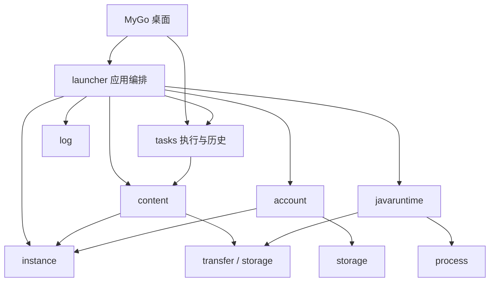

# 架构

LXMCL 使用 Go、MyGo 原生窗口和 Lobe MyGo 组件。主包负责界面状态和事件分发，后端包不依赖 UI。文件、网络和进程操作由后台任务执行，结果通过 UI 线程展示。

## 模块与接口

| 模块 | 边界与主要接口 |
| --- | --- |
| `internal/launcher` | 应用编排与外部服务适配。`Game.Execute` 接收 `LaunchRequest`，返回 `LaunchResult`；现有游戏、账号与资源 API 保持兼容。 |
| `internal/account` | Microsoft、皮肤站认证及外观协议；`Client` 提供可注入的网络接口，`Vault` 加密保存凭据，`LaunchIdentity` 提供已校验的游戏身份。 |
| `internal/instance` | 实例配置、加载器和启动参数校验，不执行网络或 UI 操作。 |
| `internal/javaruntime` | `Probe` / `Find` 探测 Java；`Manager.Local` 只检查本地；`Resolve` 按需求选取或安装；`Ensure` 校验并安装受管运行时。 |
| `internal/content` | `Kind` 定义资源格式；`List` / `Import` / `SetEnabled` / `WriteVerified` 管理实例资源文件，不依赖下载平台。 |
| `internal/tasks` | `Run` 管理一次执行的进度生命周期；`Record` 保存任务目标与结果；`Journal` 串行更新历史。 |
| `internal/server` | 服务器地址校验和状态探测。 |
| `internal/saves` | 世界备份与恢复，保留已有世界。 |
| `internal/transfer` | 下载字节、摘要和大小校验、文件发布、并发批次与取消；来源和业务重试由调用方决定。 |
| `internal/storage` | 文件读写和路径校验。 |
| `internal/process` | 平台进程属性；进程的业务生命周期由调用方管理。 |
| `internal/log` | 游戏与加载器安装器的日志路径、写入文件创建及游戏日志预览。 |
| `internal/i18n` | 从嵌入式 JSON 按键读取后端文案，保留错误链与语言回退。 |

依赖向下流动：桌面调用应用编排，编排组合领域模块和基础设施。`account`、`content`、`javaruntime`、`tasks`、`instance` 等包不反向导入 `launcher`。任务记录可引用资源类型，不能引用桌面组件或启动器实例状态。`launcher` 的类型别名和薄包装保留现有调用接口，协议和文件操作交给对应模块。

## 启动与账号

提交时调用 `LaunchRequest.Snapshot`，捕获实例 ID、修订、游戏目录、账号、设置和服务器。`Game.Execute` 检查请求内实例与状态一致，依次完成认证、安装和启动；已安装游戏遇到 `ErrRepairRequired` 时仅修复并重试一次。只安装模式跳过认证和游戏启动。浏览其他实例不改变该请求的目标。

`launch_request.go` 定义契约，`launch_auth.go` 协调会话验证、凭据保存与账号选择的状态更新，`launch_operation.go` 编排步骤。Microsoft 和皮肤站的协议、外观、会话内部字段及凭据编解码归 `account` 管理；它不读取启动器配置，也不决定当前选中的账号。认证失败会终止本次启动；已提交的凭据或状态变化通过 `LaunchResult` 返回，即使后续下载失败也不会丢失这些变化。第三方认证仅用于选择皮肤站账号的启动请求。

`account.Client` 的零值使用标准网络传输，可通过 `Transport` 注入代理策略或协议测试。请求有超时限制且不跟随认证重定向。显式客户端提供设备码登录、Microsoft 刷新、皮肤站角色绑定与验证、外观读写和启动选项；已有会话方法使用默认客户端。皮肤站的 API 发现只允许同源跳转，authlib-injector 仍按固定官方版本校验。

会话通过 `LaunchIdentity()` 返回已校验的身份，离线身份由 `OfflineIdentity` 创建。身份的 `Arguments()` 返回独立的 Minecraft 参数映射，启动器不再读取会话内部令牌；该映射含访问凭据，不可记录到日志。身份对象本身的 JSON 和格式化输出不含令牌。`Vault` 沿用 `microsoft-account.dat` 和 `skin-stations/<key>.dat`、旧 JSON 字段及当前 Windows 用户的 DPAPI 加密；其他平台不写明文凭据。账号选择仍存于 `launcher.json`，与凭据文件分离。

调用方负责串行执行会修改配置的操作。`Execute` 在调用线程运行，应放入后台任务；进度回调也在工作线程触发。取消影响认证、下载和启动前的准备，成功创建的游戏进程独立于启动器窗口。`Running` 只表示 Java 进程已启动，`Running.Done` 表示进程退出，均不等同于游戏可玩。

## Java 运行时

需求来自已校验 Minecraft 元数据的 `javaVersion.component` 和 `majorVersion`。显式 Java 路径优先且失败时不回退；自动模式依次检查系统和受管缓存，再下载官方运行时。诊断调用 `Local`，不会触发下载。

自动安装当前支持 Windows x64，使用 Mojang 官方目录和 HTTPS 下载来源。清单路径、类型、大小、大小写冲突及文件摘要均先校验；下载到同级临时目录，全部文件校验并实际探测版本后，以唯一目录名发布。失败或取消会清理本次临时目录，旧安装保持可用。再次使用时校验清单与全部文件。并发安装在进程内串行化，任务可在等待时取消。

运行时按 `cache/java/windows-x64/<component>/runtime-<manifest-sha1>-<id>/` 保存。原版启动和 Forge / NeoForge 安装共用这一模块；未来增加平台适配时需实现该平台清单类型、可执行位及真实探测，不能直接复用 Windows 路径假设。

## 任务与重试

`tasks.Run(ctx, work, report)` 是一次执行，负责开始前取消检查、串行进度和结束后屏蔽迟到回调。游戏启动、资源任务和整合包安装均接入此接口。工作函数须响应 context 并等待自己的子任务结束。调度、业务重试和 UI 节流由调用方负责。

新记录在提交时生成稳定 ID，进程启动和退出更新同一条记录。每个数据目录使用一个 `Journal`，写入者串行合并当前记录并保存临时文件，避免旧任务覆盖后来记录。内存快照以不可变数据发布，UI 读取不获取磁盘写入锁，也不能通过修改资源指针影响历史。写入失败单独报告，内存保留实际任务结果。

首次读取历史失败时不会标记为已加载，后续写入继续报告读取错误并保留原文件；修复文件后可以重试加载。读写限制均为 2 MiB，完整 JSON 文档必须有效，合法数组后的垃圾数据也会拒绝。超大结果不会覆盖已保存的历史。

`tasks.json` 保持原 JSON 数组和最近 24 条上限；旧记录通过时间戳匹配，原有中文状态与动作值保留为存储标识，不能随界面语言改变。重试目标由 `launcher.RetryTarget` 检查实例 ID、修订、版本及账号；资源重试还保留资源版本或独立文件夹。旧配置变化后不猜测新的目标。

## 文件、资源和安装

实例使用独立游戏目录，共享经过官方哈希和大小校验的下载缓存。Minecraft 目录、元数据、安装校验、参数和进程启动分文件维护；Forge 安装器、运行库与配置，以及整合包清单和实例安装流程分别维护。

Modrinth / CurseForge 适配器负责查询、版本选择和下载来源；`content` 负责 JAR / ZIP 格式、文件名、实例目录访问、启停和导入校验。添加资源只安装选中文件，必要前置由用户选择。整合包按显式清单安装依赖，在同级临时目录完成归档、依赖和游戏校验后才发布实例并保存配置。

Forge / NeoForge 官方客户端安装器在独立缓存临时目录运行，不执行整合包脚本或沿用已有 Minecraft 配置。运行库按加载器、游戏版本和平台隔离；Fabric / Quilt 使用各自官方启动配置。Maven 回退仅切换预设 HTTPS 来源下的同一路径，校验值仍来自官方元数据。CurseForge 密钥只用于官方 API，不发送给下载来源或 Java 子进程。

## 扩展约定与参考

增加下载平台时实现查询与文件描述适配，复用 `content` 和 `transfer`；增加后台操作时提交独立目标快照，复用 `tasks`，在所属业务模块决定重试条件；新增日志格式或输出去向进入 `log`；新增文案同时维护中英文 JSON 的键和格式参数。接口由实际调用需求决定，目前没有插件 SDK、任务恢复调度器或账号提供者注册框架。

设计参考了 [HMCL 的 Mojang Java 安装任务](https://github.com/HMCL-dev/HMCL/blob/main/HMCLCore/src/main/java/org/jackhuang/hmcl/download/java/mojang/MojangJavaDownloadTask.java)中运行时安装的独立职责，以及 [Prism Launcher 的任务接口](https://github.com/PrismLauncher/PrismLauncher/blob/develop/launcher/tasks/Task.h)中进度、取消与结束状态的区分。这里使用 Go context、明确的请求/结果和组合实现，未引入它们的任务类继承结构或复制实现源码。
